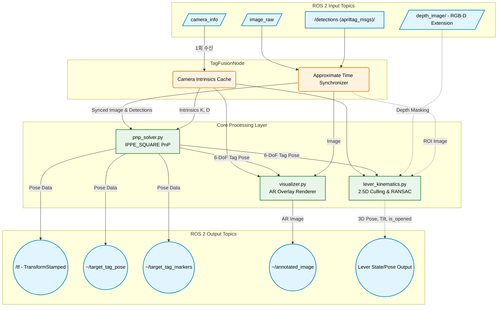

# AprilTag 6-DoF & Lever Kinematics Package

`apriltag_6dof`는 ROS 2 환경에서 다중 AprilTag의 6자유도(6-DoF) 위치와 자세를 실시간으로 추정하고, RGB-D 데이터를 융합하여 배전반 도어 레버(손잡이)의 3D 자세 및 개폐 상태까지 정밀하게 추정하는 컴퓨터 비전/기하 연산 패키지입니다.

## 🌟 주요 기능
* **고속/고정밀 6-DoF 추정:** `IPPE_SQUARE` 기반의 PnP 솔버를 통해 평면 마커의 3D 포즈를 안정적으로 추정합니다.
* **실시간 다중 태그 추적:** 시야 내 모든 AprilTag의 TF2 좌표계와 3D 마커(MarkerArray)를 일괄 브로드캐스트합니다.
* **AR 오버레이 시각화:** 원본 영상 위에 3D 좌표축, 바운딩 박스, OSD 텍스트를 증강(AR)하여 퍼블리시합니다.
* **2.5D Culling & RANSAC 레버 상태 추정:** 태그를 기준점(Anchor)으로 삼아 도어 평면을 인식하고, 2.5D 깊이 필터링과 RANSAC 알고리즘을 통해 레버의 미세한 돌출, 기울기, 개폐 상태(Hysteresis 상태 머신)를 추정합니다.

---

## 🏗️ 소프트웨어 아키텍처

내부 구조는 데이터 모델, 순수 기하/비전 연산, 시각화, ROS 2 통신이 명확히 분리된 **계층형 아키텍처(Layered Architecture)**를 따릅니다.

| 계층 (Layer) | 주요 모듈 | 핵심 역할 및 책임 |
| :--- | :--- | :--- |
| **ROS 2 통신 계층** | `tag_fusion_node.py` | 토픽 구독, 시간 동기화, TF/Pose/Marker 브로드캐스트 |
| **핵심 기하 연산 계층** | `pnp_solver.py` | PnP 자세 추정, 쿼터니언 변환, 재투영 오차 산출 |
| **레버 상태 추정 계층** | `lever_kinematics.py` | 2.5D 점군 Culling, RANSAC 평면 피팅, 개폐 상태 추론 |
| **시각화 계층** | `visualizer.py` | OpenCV 기반 2D/3D AR 오버레이 렌더링 |
| **도메인 모델 계층** | `models.py` | 불변(Immutable) DTO 정의 (`CameraIntrinsics`, `Pose6DoF` 등) |

---

## 🔄 데이터 흐름도 (Data Flow Pipeline)

아래 순서도는 노드 내에서의 데이터 수집, 동기화, 연산, 그리고 최종 결과물 발행까지의 전체 파이프라인을 보여줍니다.



*(참고: 점선 화살표는 `lever_kinematics.py`를 활용한 RGB-D 확장 파이프라인의 데이터 흐름을 나타냅니다.)*

---

## 🛠️ 모듈별 상세 설명

### 1. `models.py` (도메인 데이터 모델)
* 시스템 전반에서 사용되는 데이터 구조체 정의.
* 멀티스레딩 환경의 안정성을 위해 `@dataclass(slots=True, frozen=True)`를 사용하여 데이터의 불변성(Immutability)을 보장합니다.

### 2. `pnp_solver.py` (6-DoF PnP 솔버)
* 평면 사각 마커에 특화된 `cv2.SOLVEPNP_IPPE_SQUARE` 알고리즘을 사용합니다.
* 수렴 실패 시 일반 반복 최적화(`ITERATIVE`) 방식으로 전환되는 이중 솔버 전략을 채택했습니다.
* AR 렌더링 축과 TF2 자세가 100% 일치하도록 좌표계를 보정합니다.

### 3. `lever_kinematics.py` (레버 상태 추정 엔진)
* **2D 형태학 연산:** 도어 표면에 투영된 공칭 영역(ROI)에서 형태학적(Morphological) 그래디언트를 통해 레버의 바운딩 박스를 락킹합니다.
* **2.5D Depth Culling:** 도어 평면 방정식을 이용해 10mm ~ 80mm 사이의 점군(순수 레버)만 남기고 노이즈(문틈, 배경)를 완벽히 제거합니다.
* **RANSAC & SVD 피팅:** 남은 점군에 대해 3D 평면을 피팅하고 PCA를 통해 레버의 정밀한 방향 벡터와 기울기(Tilt)를 산출합니다.
* **Hysteresis 필터링:** 센서 노이즈로 인한 채터링을 막기 위해 개폐 임계값에 불감대를 적용하고, 지수이동평균(EMA)과 NLERP로 시계열 궤적을 부드럽게 보정합니다.

### 4. `tag_fusion_node.py` (ROS 2 통합 노드)
* 카메라의 영상과 AprilTag 검출 결과를 `ApproximateTimeSynchronizer`로 묶어 근사 동기화 처리합니다.
* `MultiThreadedExecutor`를 통해 여러 콜백을 병렬 처리하며 연산 지연을 최소화합니다.
* 다수의 마커 좌표를 배열 형태로 한 번에 브로드캐스트(TF)하여 통신 부하를 줄입니다.

### 5. `visualizer.py` (AR 렌더러)
* 검출된 태그의 바운딩 박스, 중심점, 3D 직교 좌표축, 그리고 거리 및 오차 정보를 이미지 위에 오버레이하여 시각적 피드백을 제공합니다.

---

## 🚀 실행 방법 (예시)

일반적인 ROS 2 `launch` 파일을 통해 노드를 실행할 수 있습니다.

```bash
# 워크스페이스 빌드 후 환경 소싱
source install/setup.bash

# 단일 노드 실행
ros2 run apriltag_6dof tag_fusion_node --ros-args -p track_all_tags:=true -p tag_size:=0.048

# 런치 파일을 통한 전체 시스템 실행 (예시)
ros2 launch apriltag_6dof tag_fusion.launch.py
```
